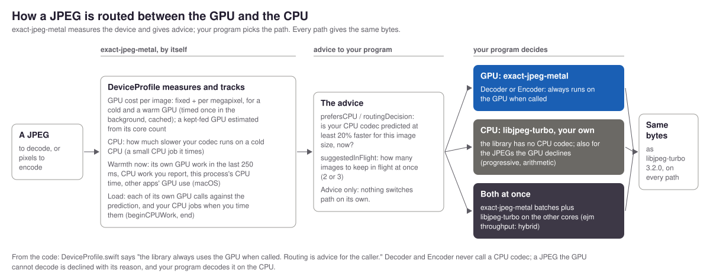
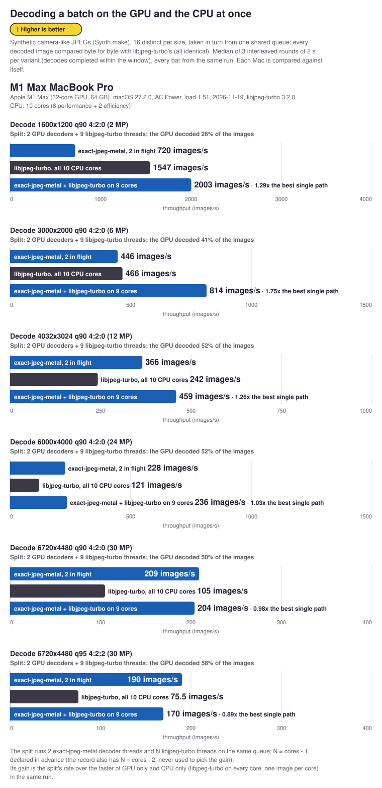
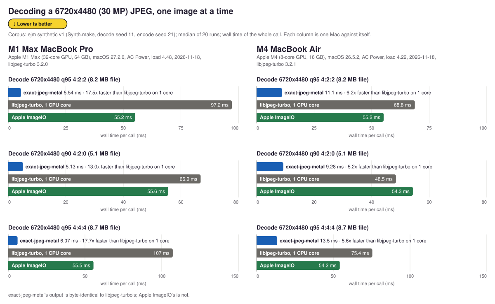
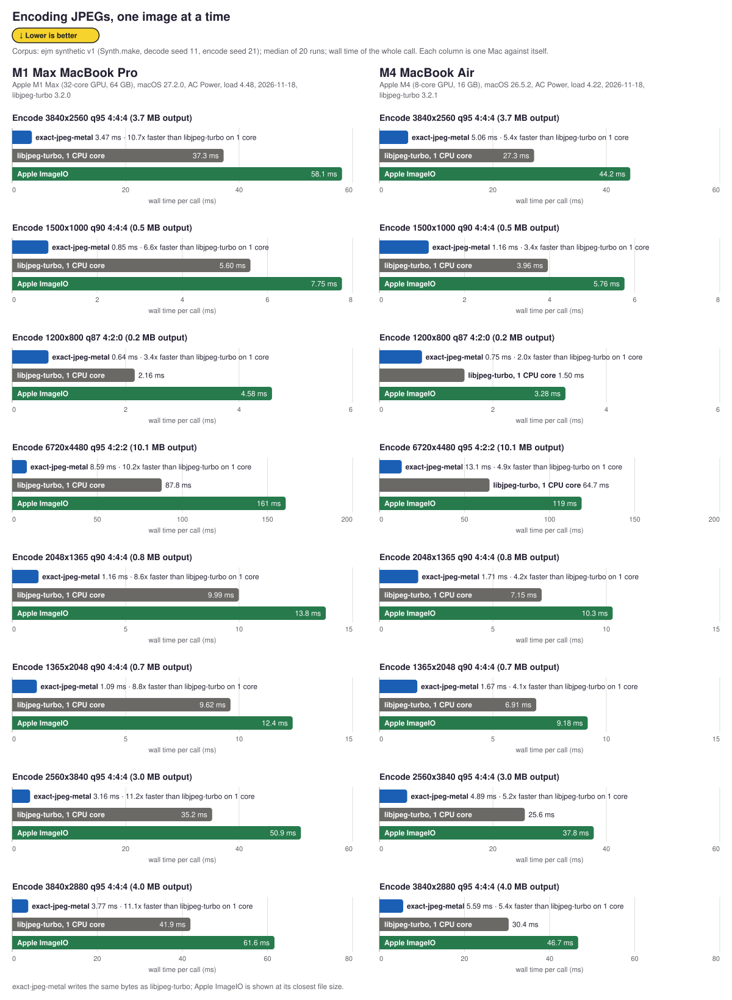
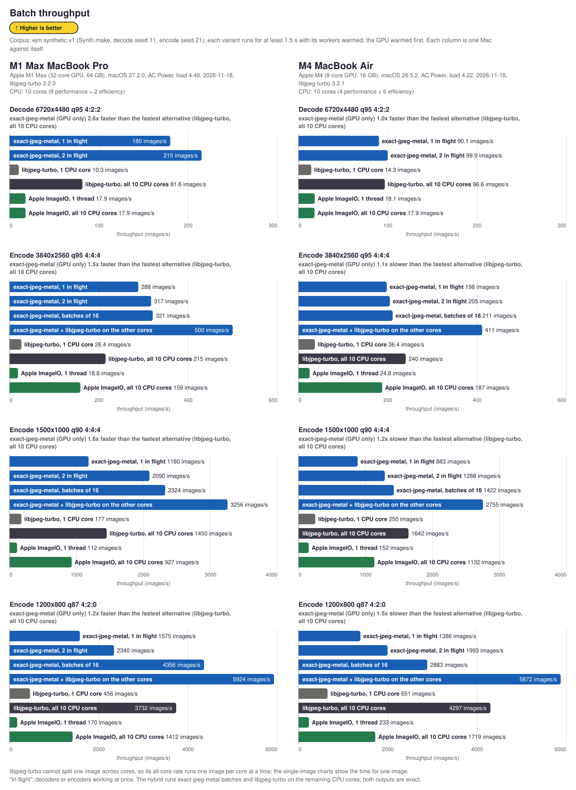
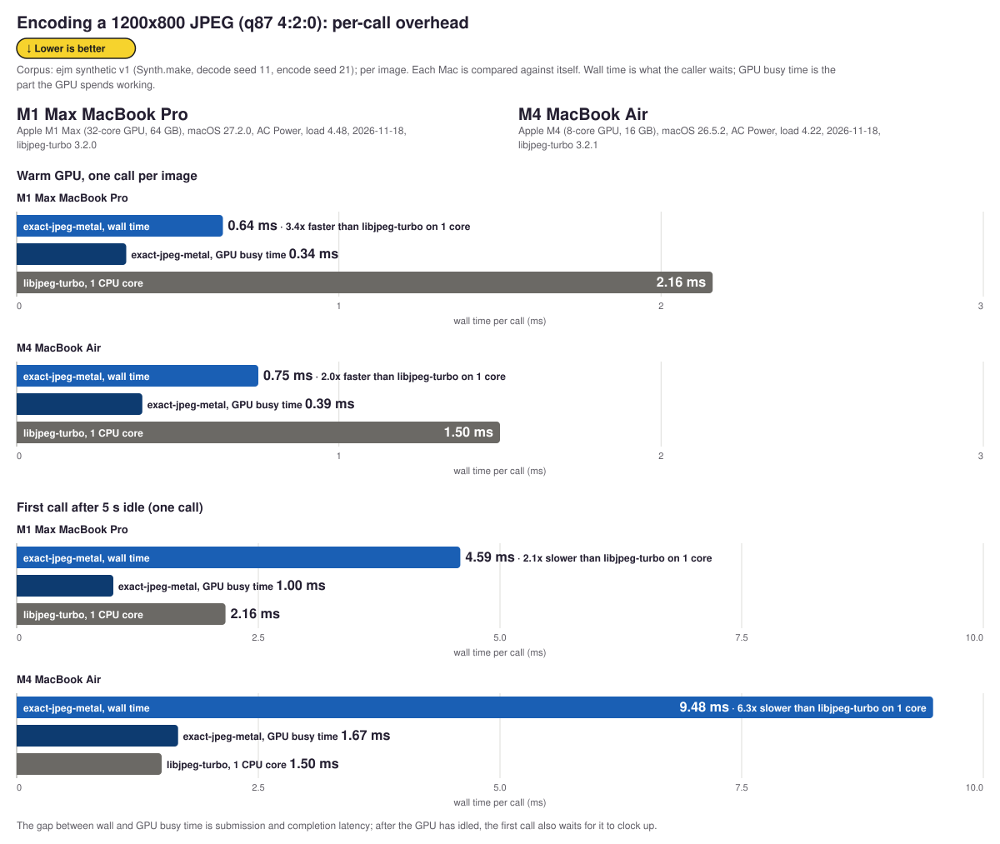
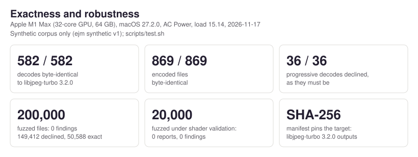

# exact-jpeg-metal

**A JPEG decoder and encoder for Apple GPUs (Mac and iPhone) whose output is identical to libjpeg-turbo's:
decoded pixels and encoded files equal libjpeg-turbo 3.2.0's, byte for byte.** Every number and test result here
is from one machine of each kind: an M1 Max MacBook Pro (32-core GPU), an M4 MacBook Air (8-core GPU) and an
iPhone 13 (A15). No other Apple GPU has run it.


**Tested hard.** The test suite (`scripts/test.sh`, passed on 2026-11-19 on an M1 Max): a synthetic corpus of 309
files with 582 of 582 decodes identical and 36 progressive decodes declined; 869 of 869 encoded files identical,
compared as whole files; a decline corpus of 60 files (120 decodes) with 0 wrong; 50,000 fuzzed files, 5,000 more
under Metal shader validation and 5,000 fuzzed encodes, 0 findings; 35 groups of API checks. The committed record
of an earlier run has 200,000 fuzzed files with 0 findings. The M4 passed the same suite with libjpeg-turbo 3.2.1
installed, checked against the pinned 3.2.0 hashes; the iPhone 13 check app passed the corpora (582 and 36),
873 of 873 pixel-format decodes and 879 of 879 encodes. On the sister library's public set,
imagecompression.info's 8-bit test images (14 photos) and libjpeg-turbo's three benchmark frames, 17 images at 6
settings each: 102 of 102 decodes identical to libjpeg-turbo, all on the GPU, on the M1 Max, the M4 and the
iPhone 13, and 68 of 68 comparable encodes byte-identical to Pillow's files on both Macs. The images are
downloaded by `scripts/get-pc-set.py`, which checks the two archives' and all 102 JPEGs' SHA-256; no image is in
the repository.
<!-- numbers: scripts/test.sh run of 2026-11-19 (log not committed); results/exactness.json (200,000 fuzz, M1 Max, 2026-11-17); results/ios/iphone13-2026-11-19-0755-check.json; results/public/m1max-gpu32-2026-11-19-1333-pc-set.json; results/public/m4-gpu8-2026-11-19-1306-pc-set.json; results/ios/iphone13-2026-11-19-1307-pc-set.json -->

**What "identical" covers.** Decoding: 8-bit baseline and extended-sequential Huffman JPEGs with one scan,
grayscale or YCbCr, 4:4:4, 4:2:2, 4:2:0, 4:4:0, 4:1:1 and other integral sampling factors, with or without restart
markers, any valid Huffman tables. Output as RGB, BGR, gray, RGBA or BGRA. Encoding: RGB (or RGBA with the alpha
ignored), quality 1 to 100, 4:4:4, 4:2:2 or 4:2:0, with or without an ICC profile and EXIF. A file the GPU path
cannot decode exactly (progressive and the rest in [the claim](#the-claim)) is declined with a reason, never
approximated: the call returns `nil` and you decode that file with your CPU codec. There are no fast or
approximate modes; every setting changes speed or memory, never an output byte.

**Other decoders, measured.** On the 102 public-set JPEGs, against libjpeg-turbo 3.2.0 with the accurate IDCT and
fancy upsampling, on both Macs, Apple ImageIO was identical on 0 of 102 and differed by up to 110 levels at 4:2:0,
3 at 4:4:4 and 1 for gray. VideoToolbox (Apple's hardware JPEG decoder) was identical on 0 of 102 and differed by
up to 255 levels. Part of that is its colour conversion, but not all. In a separate study of one photo on the
M1 Max (deer, encoded at q95 as 4:2:0 and as 4:4:4, both with the same luma data), its luma plane from the 4:2:0
file differed from libjpeg-turbo's by at most 1 level; from the 4:4:4 file, by a maximum of 92 to 133 levels, with
about 88% of samples differing. On the iPhone 13, ImageIO was identical on 0 of 102 (up to
110).
<!-- numbers: results/public/m1max-gpu32-2026-11-19-1333-pc-set.json, results/public/m4-gpu8-2026-11-19-1306-pc-set.json (summary.others and files[].others); results/research/vt-444-luma-2026-11-18/README.md; results/ios/iphone13-2026-11-19-1307-pc-set.json -->

**1. The same bytes.** Identical bytes mean:

- JPEG work moves between libjpeg-turbo and the GPU, or from a Mac to an iPhone, without changing any result, so
  hashes, caches and regression tests keep matching;
- a file the GPU declines (progressive, for example) is one your program decodes with libjpeg-turbo instead, and
  nobody can tell which path ran;
- it is the same claim as [exact-gpu-jpeg](https://github.com/mrluker/exact-gpu-jpeg), the sister library for
  NVIDIA GPUs, on the same public set.

**2. Fast on Apple GPUs.** The whole decode runs on the GPU, including the Huffman stage that most decoders keep on
the CPU, and the encode does too. One image at a time:

- **On the public set**, the median decode over the 102 JPEGs took 2.53 ms on the M1 Max, against 21.3 ms for
  libjpeg-turbo on one core, 13.6 ms for ImageIO and 12.1 ms for VideoToolbox. The median of the per-file speed-ups
  was 9.33× libjpeg-turbo, 6.06× ImageIO and 5.03× VideoToolbox. On the M4: 3.05 ms against 15.1, 13.5 and
  10.4 ms (5.23×, 4.27× and 3.46×).
- **A 39 MP photo** (big_building, q95 4:2:0) in 7.2 ms on the M1 Max, against 136 ms for libjpeg-turbo on one
  core (19×), 67.8 ms for ImageIO and 52.3 ms for VideoToolbox. On the M4: 14.4 ms against 96.2, 63.6 and 46.0 ms.
- **Encoding**, on a synthetic 3840×2560 q95 4:4:4 image: 3.47 ms on the M1 Max against 37.3 ms for
  libjpeg-turbo on one core (10.7×); 5.06 ms against 27.3 ms on the M4 (5.4×).
- **Against all CPU cores**, decoding 6720×4480 (30 MP) synthetic photos with two decoders in flight: 215 images a
  second on the M1 Max against 81.6 for libjpeg-turbo on all 10 cores; on the M4, 99.9 against 96.6, about level.
- **On the iPhone 13**, a 39 MP photo in 42.2 ms against 72.1 ms for ImageIO, and synthetic 1600×1200 photos at
  2.96 ms each with two decoders in flight, against 4.87 ms for ImageIO on two threads.
<!-- numbers: results/public/m1max-gpu32-2026-11-19-1333-pc-set.json and results/public/m4-gpu8-2026-11-19-1306-pc-set.json (files[].ms: medians over 102 and per-file ratios); results/bench/m1max-gpu32-2026-11-18-1345.json and results/bench/m4-gpu8-2026-11-18-0744.json (encode, throughput); results/ios/iphone13-2026-11-19-1307-pc-set.json; results/ios/iphone13-2026-11-19-0755-check.json (timing.rows) -->

**3. Decoding the same photo again: UnHuff.**

*UnHuff: a Huffman-free coefficient format for exact repeat JPEG decodes.*

A viewer, an editor or a culling pass often decodes the same photo several times. `Decoder.decodeAndPack` decodes
a JPEG and also keeps an UnHuff copy of it in memory: its quantised coefficients, packed with no Huffman coding.
`Decoder.decode(packed:)` then decodes that copy without the Huffman stage, the slowest step. The pixels are the
same as a fresh decode's, in every output format. It is opt-in: `decode` never packs.

```swift
import Foundation
import ExactJPEG

let data = try Data(contentsOf: URL(fileURLWithPath: "photo.jpg"))
let dec = Decoder()
if case let (img, packed?)? = dec.decodeAndPack(data) {  // the first decode, plus the UnHuff copy
    let again = dec.decode(packed: packed, format: .bgra)  // later decodes skip the Huffman stage
    print(img.width, again?.width ?? 0)
}
```

On the M1 Max, repeat decodes of 30 MP (6720×4480) synthetic photos took 2.07 ms instead of 5.56 ms at q95 4:2:2
(63% less), 1.88 ms instead of 5.15 ms at q90 4:2:0 (63% less) and 2.62 ms instead of 6.10 ms at q95 4:4:4 (57%
less). Packing costs 9.7 to 15.1 ms of CPU once, after the first decode. The copy holds 12.4 to 22.6 MB of memory
per 30 MP, against 94 to 188 MB for plain coefficient arrays, plus its own copy of the JPEG bytes. Every packed
decode in that run was identical, and so were all 102 public-set decodes through UnHuff on the M1 Max and the M4.

UnHuff lives in memory only, in one process; there is no file form and no way to save or load a copy. Its
buffers are checked before every read, and when a check fails the decoder decodes the kept JPEG bytes normally,
so a bad copy costs time, never pixels. Details: [docs/API.md](docs/API.md#decoding-the-same-photo-again-unhuff).
<!-- numbers: results/packed/m1max-gpu32-2026-11-19-1157.txt (ejm packed-bench 5); summary.from_packed_identical in results/public/m1max-gpu32-2026-11-19-1333-pc-set.json and results/public/m4-gpu8-2026-11-19-1306-pc-set.json -->

**4. It finds the fastest exact route and advises your program.**



By itself, `DeviceProfile` measures the GPU's cost per image once in the background (cached per GPU, OS build and
library version), times a small CPU job to learn how much slower a cold CPU is, tracks whether the GPU and CPU are
warm and how loaded, and corrects its predictions against its own GPU calls. What it gives your program is advice:
`prefersCPU` (or `routingDecision`, with the predictions behind it) advises the CPU when your CPU codec is predicted
at least 20% faster for that image now, and `suggestedInFlight` says how many images to keep in flight. Nothing
switches path on its own: `Decoder` and `Encoder` always run on the GPU when called, and the library has no CPU
codec. A JPEG the GPU declines comes back with its reason, for your program to decode with libjpeg-turbo. Running
both at once, GPU batches plus libjpeg-turbo on the other cores, is also your program's choice; the hybrid bars in
the [throughput chart](docs/images/throughput.svg) show it. Encoding 3840×2560, that mix reached 500 images a
second on the M1 Max (GPU batches alone 321, libjpeg-turbo on all 10 cores 215) and 411 on the M4 (211 and 240).
Decoding works the same way. Two GPU decoders plus libjpeg-turbo on 9 cores, all taking JPEGs from one shared
queue, against the faster of the GPU alone and libjpeg-turbo on all 10 cores: 1.29× at 2 MP, 1.75× at 6 MP,
1.26× at 12 MP, 1.03× at 24 MP, 0.98× at 30 MP 4:2:0 and 0.89× at 30 MP 4:2:2. So the mix pays below about 20 MP;
above that the GPU alone is as fast or faster. Every decode was identical to libjpeg-turbo's (111,158 of 111,158).
This is one M1 Max run on synthetic camera-like images (load 1.5 at the start, 14 at the end, mostly from its own
11 threads); the M4 has not been measured yet.
<!-- numbers: results/bench/m1max-gpu32-2026-11-19-1822-decode-split.json (sizes[].gain, split-9 against best_single; exact; conditions.load_average_before/after) -->



```swift
let p = DeviceProfile.current
if p.prefersCPU(width: 640, height: 480, operation: .decode) { /* libjpeg-turbo, then DeviceProfile.noteCPUWork() */ }
```
<!-- numbers: results/bench/m1max-gpu32-2026-11-18-1345.json; results/bench/m4-gpu8-2026-11-18-0744.json (throughput-encode 3840x2560: hybrid, metal-batch16, libjpeg-turbo all cores) -->

**Where it loses, or is unproven.**

- **One image at a time on the iPhone 13.** ImageIO was faster on 73 of the 102 public-set JPEGs, the small and
  mid-size ones (all 73 at 11.1 MP or less; 17 JPEGs of 7.4 to 12.1 MP were faster here): median 17.0 ms for this
  library against 12.5 ms.
  Each call pays a fixed GPU cost of about 7 to 13 ms on the A15, because its GPU drops to a slow clock between
  isolated calls. This library was faster on all 12 JPEGs above 20 MP (2 photos at 6 settings), and with two decoders in flight it was
  faster than ImageIO on two threads on synthetic photos from 488×480 up. ImageIO is not identical, so an app that needs exact output on that path must
  bundle libjpeg-turbo ([why](docs/HOW-IT-WORKS.md#why-one-call-at-a-time-is-slow-on-the-iphone-13)).
- **Small rendered frames on the Macs.** On libjpeg-turbo's 1.2 MP benchmark frames, libjpeg-turbo on one core was
  faster on 4 of 102 JPEGs on the M1 Max (for example 2.92 ms against 4.66 ms) and on 6 of 102 on the M4 (1.71 ms
  against 2.91 ms). ImageIO was faster on 1 of 102 on the M1 Max, VideoToolbox on 3 of 102 on the M4, all on the
  same frames.
- **All CPU cores on the M4.** With libjpeg-turbo on all 10 cores, the 8-core GPU is level for decode (99.9 against
  96.6 images a second at 30 MP) and slower for encode (up to 211 against 240 at 3840×2560, with batches of 16; 205 with 2 in flight).
- **After an idle GPU.** The first 1200×800 encode after 5 s of idle took 9.48 ms on the M4 against 1.50 ms for
  libjpeg-turbo on one core, and 4.59 ms on the M1 Max against 2.16 ms. Warm, the same encode takes 0.75 and
  0.64 ms.
- **Progressive files** are declined, so they cost a libjpeg-turbo decode on the CPU. On the M1 Max, 13
  progressive files of three other public sets (libjpeg-turbo's test images, zune-jpeg's, Google's venice) were all
  declined, and the other 38 decoded identical (`results/public/m1max-gpu32-2026-11-19-1144.json`).
- **One device of each kind.** No other Apple GPU has run it. The bytes are libjpeg-turbo's as
  built for arm64 (NEON); other libjpeg-turbo versions than 3.2.0 and 3.2.1 were not checked.
<!-- numbers: results/ios/iphone13-2026-11-19-1307-pc-set.json (records[].metal_decode.wall_ms, records[].imageio.ms_1_thread); results/ios/iphone13-2026-11-19-0755-check.json; results/public/m1max-gpu32-2026-11-19-1333-pc-set.json; results/public/m4-gpu8-2026-11-19-1306-pc-set.json; results/bench/m4-gpu8-2026-11-18-0744.json; results/bench/m1max-gpu32-2026-11-18-1345.json; results/public/m1max-gpu32-2026-11-19-1144.json -->

### Against libjpeg-turbo, ImageIO and VideoToolbox, on the public set

One image at a time, from the JPEG bytes in memory to RGB pixels, median of 9 calls per JPEG; each Mac against
itself. "Median ratio" is the median over the 102 JPEGs of each one's time divided by this library's.

| | this library | libjpeg-turbo, one core | Apple ImageIO | VideoToolbox |
|---|---|---|---|---|
| M1 Max: median over 102 JPEGs | **2.53 ms** | 21.3 ms | 13.6 ms | 12.1 ms |
| M1 Max: median ratio | | 9.33× slower | 6.06× slower | 5.03× slower |
| M1 Max: big_building q95 4:2:0 (39 MP) | **7.18 ms** | 136 ms | 67.8 ms | 52.3 ms |
| M4: median over 102 JPEGs | **3.05 ms** | 15.1 ms | 13.5 ms | 10.4 ms |
| M4: median ratio | | 5.23× slower | 4.27× slower | 3.46× slower |
| M4: big_building q95 4:2:0 (39 MP) | **14.4 ms** | 96.2 ms | 63.6 ms | 46.0 ms |
| identical to libjpeg-turbo, both Macs | **102 of 102** | (reference) | 0 of 102, up to 110 levels | 0 of 102, up to 255 levels |
<!-- numbers: results/public/m1max-gpu32-2026-11-19-1333-pc-set.json; results/public/m4-gpu8-2026-11-19-1306-pc-set.json -->


The chart's iPhone 13 panel times this library and ImageIO only (libjpeg-turbo and VideoToolbox are not timed on
iOS): median 17.0 ms against 12.5 ms, so ImageIO is faster one call at a time on most of the set (see "Where it
loses" above), while big_building q95 4:2:0 took 42.2 ms against 72.1 ms.
<!-- numbers: results/ios/iphone13-2026-11-19-1307-pc-set.json -->

Measured on 2026-11-19: the M1 Max at load 2.2 to 2.4, the M4 at 1.4 to 2.3, thermal state nominal. To repeat it
on your own Mac ([docs/CLI.md](docs/CLI.md#benchmarks)):

```bash
python3 scripts/get-pc-set.py <dir outside the repo>   # downloads both archives, checks SHA-256, makes the 102 JPEGs (Pillow 13.0.0)
Tools/.build/release/ejm pc-set <dir>                  # exactness and timing, written to results/public/
```

### On synthetic photos

The charts below are from `scripts/bench.sh` on synthetic images (`ejm synthetic v1`): this library's times are the median of 20 runs,
libjpeg-turbo's on one core the median of 10 calls after 1 s of the same work. Every
Metal output in these runs was byte-identical to libjpeg-turbo's.









| synthetic task | M1 Max | libjpeg-turbo, 1 core | M4 | libjpeg-turbo, 1 core |
|---|---|---|---|---|
| decode 6720×4480 q95 4:2:2 | 5.54 ms | 97.2 ms (17.5×) | 11.1 ms | 68.8 ms (6.2×) |
| encode 3840×2560 q95 4:4:4 | 3.47 ms | 37.3 ms (10.7×) | 5.06 ms | 27.3 ms (5.4×) |
| encode 1200×800 q87 4:2:0 | 0.64 ms | 2.16 ms (3.4×) | 0.75 ms | 1.50 ms (2.0×) |
| decode 6720×4480, images/s, vs all 10 cores | 215 | 81.6 | 99.9 | 96.6 |
| encode 3840×2560, images/s, vs all 10 cores | 321 (batches of 16) | 215 | 205 (2 in flight) | 240 |
<!-- numbers: results/bench/m1max-gpu32-2026-11-18-1345.json; results/bench/m4-gpu8-2026-11-18-0744.json -->

### The claim

| | decoding | encoding |
|---|---|---|
| equal to | **libjpeg-turbo 3.2.0** (Homebrew, arm64 NEON build) with the accurate integer IDCT (`JDCT_ISLOW`) and fancy upsampling: libjpeg-turbo's and TurboJPEG's defaults, and Pillow's `Image.open(...).convert("RGB")`. The M4 also passes with 3.2.1 installed | **libjpeg-turbo 3.2.0's** baseline compressor with `jpeg_set_quality` tables, standard Huffman tables and the islow DCT, which is what Pillow 13.0.0 writes with `Image.save(f, "JPEG", quality=q, subsampling=s)` (68 of 68 public-set encodes) |
| what is equal | every byte of the decoded pixels (RGB, BGR, gray, RGBA or BGRA) | every byte of the file: header, tables and compressed data |
| for | 8-bit baseline and extended-sequential Huffman JPEGs with one scan holding all components: grayscale or YCbCr; 4:4:4, 4:2:2, 4:2:0, 4:4:0, 4:1:1 and other integral sampling factors; with or without restart markers; any valid Huffman tables, the standard tables when a file has none (Motion-JPEG); 8- or 16-bit quantisation tables; up to `maxPixels` (2^28 by default) | RGB, or RGBA/RGBX with the alpha byte ignored, any row pitch; quality 1 to 100; 4:4:4, 4:2:2, 4:2:0; with or without an ICC profile and EXIF |
| declined, never approximated | progressive, arithmetic-coded, lossless, hierarchical and 12-bit files; CMYK and YCCK; RGB-coded JPEGs (Adobe transform 0 or component ids "RGB"); multi-scan sequential files; fractional sampling factors; corrupt or truncated files; coefficients where libjpeg-turbo's SIMD and C IDCTs could differ; a 16-bit quantisation value above 32767; images needing more GPU memory than `maxGPUBytes` (half the working set by default). The call returns `nil` (C: `EJM_DECLINED`) with a reason, and you decode the file with libjpeg-turbo | everything libjpeg-turbo's defaults do not write (optimised tables, progressive, restart markers, grayscale output): not offered |
| files libjpeg-turbo warns about | three warnings that leave the pixels unchanged are accepted (extraneous bytes before a marker, a missing end marker after a complete scan, an unknown JFIF version), and the fuzzer checks each such file is identical; any other warning is declined | |
| not checked | libjpeg-turbo versions other than 3.2.0 and 3.2.1; x86-64 builds; Apple GPUs other than the three named | Pillow versions other than 13.0.0 |

A startup self-check on each GPU decodes and encodes built-in images and compares SHA-256 hashes with
libjpeg-turbo's; if a single byte differs, every call on that GPU declines. The reasons, the evidence for each row
and the full decline list: [docs/API.md](docs/API.md#decline-reasons) and
[docs/HOW-IT-WORKS.md](docs/HOW-IT-WORKS.md#what-the-gpu-path-declines-and-why).



## Install

Add the package to your `Package.swift`:

```swift
dependencies: [.package(url: "https://github.com/mrluker/exact-jpeg-metal", branch: "main")],
// in your target:
dependencies: [.product(name: "ExactJPEG", package: "exact-jpeg-metal")]
```

Or build the C library from a checkout:

```bash
git clone https://github.com/mrluker/exact-jpeg-metal && cd exact-jpeg-metal
swift build -c release --product ExactJPEGC     # .build/release/libExactJPEGC.dylib, header include/exact_jpeg.h
```

Requirements: macOS 14+ or iOS 16+, an Apple GPU of Metal family Apple7 or later (M1, A14 and newer), and SwiftPM
(the Command Line Tools are enough). The library needs nothing else; its shaders compile at run time. The tests and
benchmarks (the `ejm` tool, a separate package in `Tools/`) also need libjpeg-turbo as the reference:
`brew install jpeg-turbo pkg-config`.

## Use

```swift
import Foundation
import ExactJPEG

let dec = Decoder()                                   // one per thread
guard let img = dec.decode(path: "photo.jpg", format: .rgb) else {
    fatalError(dec.reason ?? "declined")              // decode this file with libjpeg-turbo instead
}
// img.buffer is an MTLBuffer in unified memory: your own kernels read it with no copy
let enc = Encoder()                                   // one per thread
let jpeg = try enc.encode(buffer: img.buffer, offset: img.offset, width: img.width, height: img.height,
                          channels: img.channels, quality: 90, subsampling: .s420)
try jpeg.write(to: URL(fileURLWithPath: "out.jpg"))
```

`decode(_:format:)` takes `Data`, `decode(bytes:format:output:)` raw bytes and your own output `MTLBuffer`.
`encodeBatch` encodes many images in one command buffer, which is much faster for small images. To keep the GPU
busy, run one `Decoder` or `Encoder` per thread with `DeviceProfile.current.suggestedInFlight` images in flight;
`DeviceProfile.current.prefersCPU(width:height:operation:)` advises when your CPU codec would finish an image
sooner.

From C (and so C++, Rust or Python through `ctypes`), link `libExactJPEGC` and include `include/exact_jpeg.h`:

```c
#include "exact_jpeg.h"

ejm_decoder *d = ejm_decoder_create();                         /* NULL if no Metal device */
int w, h;
int r = ejm_decode(d, jpeg, len, EJM_RGB, out, capacity, &w, &h);
if (r == EJM_DECLINED) {
    printf("declined: %s\n", ejm_decoder_reason(d));           /* decode with libjpeg-turbo instead */
} else if (r != EJM_OK) {
    printf("error: %s\n", ejm_decoder_reason(d));
} else {                                                       /* out holds w x h RGB pixels */
    ejm_encoder *e = ejm_encoder_create();
    uint8_t *file; size_t file_len;
    if (ejm_encode(e, out, w, h, 3, (size_t)w * 3, 90, EJM_420, &file, &file_len) == EJM_OK)
        ejm_free(file);                                        /* after using the JPEG bytes */
    else
        printf("encode failed: %s\n", ejm_encoder_error(e));
    ejm_encoder_destroy(e);
}
```

`Examples/c/example.c` is a complete program; `./scripts/c-example.sh` builds it, runs it and checks it against
libjpeg-turbo. `./scripts/swift-example.sh` does the same for the Swift example.

Check exactness on your own Mac, and on your own files:

```bash
./scripts/test.sh                                # corpora, manifest, API checks, fuzzing, shader validation
Tools/.build/release/ejm manifest check          # both corpora against testdata/manifest-libjpeg-turbo-3.2.0.json
Tools/.build/release/ejm decode-files <dir>      # your own JPEGs: exactness and timing, names not printed
```

On an iPhone, `Examples/ios-check/run-device.sh <device id>` builds, installs and runs the check app and copies
its results back (it needs `Examples/ios-check/Config/Signing.local.xcconfig` with your `DEVELOPMENT_TEAM`).

## Documentation

- [API reference](docs/API.md): every Swift and C name, setting, decline reason and environment variable.
- [Command-line tool and scripts](docs/CLI.md): `ejm`, the test and benchmark scripts, the iPhone check app.
- [How it works](docs/HOW-IT-WORKS.md): the pipelines, what is declined and why, self-configuration, the iPhone's
  per-call cost, the comparison with exact-gpu-jpeg.
- [Parallel Huffman decoding](docs/huffman-sync.md): the self-synchronising method and what this library adds.
- [Changes](docs/CHANGES.md): every change, with the check that proves it.
- Results: [results/public/](results/public/), [results/ios/](results/ios/), [results/bench/](results/bench/),
  [results/packed/](results/packed/), [results/exactness.json](results/exactness.json).

## Tested configuration

Three machines, one of each: an M1 Max MacBook Pro (32-core GPU, 64 GB) on macOS 27.2.0 with libjpeg-turbo 3.2.0;
an M4 MacBook Air (8-core GPU, 16 GB) on macOS 26.5.2 with libjpeg-turbo 3.2.1, checked against the pinned 3.2.0
hashes; an iPhone 13 (A15, 4-core GPU) on iOS 27.2, checked against the same pinned hashes (the app does not link
libjpeg-turbo). Swift 6. Other Apple GPUs (M2, M3, Pro and Ultra chips, newer iPhones and iPads) should work, as
nothing in the kernels is specific to these three, but have not been run; the startup self-check declines all work
on a GPU that would change a byte.

Status: version 0.1, no release tag yet; depend on the `main` branch. Changes: [docs/CHANGES.md](docs/CHANGES.md).

## Credit

The Huffman stage is self-synchronising parallel decoding, the method of André Weißenberger and Bertil Schmidt
(ICPP 2018), going back to Shmuel T. Klein and Yair Wiseman (2003). This implementation was written from the
papers; no code was taken from them. The arithmetic is ported from libjpeg-turbo 3.1.2 and the Independent JPEG
Group's library, and checked against libjpeg-turbo 3.2.0.

- André Weißenberger and Bertil Schmidt, "Massively Parallel Huffman Decoding on GPUs", ICPP 2018,
  doi:10.1145/3225058.3225076; and "Accelerating JPEG Decompression on GPUs", arXiv:2111.09219.
- Shmuel T. Klein and Yair Wiseman, "Parallel Huffman Decoding with Applications to JPEG Files", The Computer
  Journal 46(5), 2003, doi:10.1093/comjnl/46.5.487.
- Wasuwee Sodsong, Minyoung Jung, Jinwoo Park and Bernd Burgstaller, "JParEnt: Parallel Entropy Decoding for JPEG
  Decompression on Heterogeneous Multicore Architectures", PMAM 2016, doi:10.1145/2883404.2883423.
- Lipeng Wang, Qiong Luo and Shengen Yan, "Accelerating Deep Learning Tasks with Optimized GPU-assisted Image
  Decoding", ICPADS 2020, doi:10.1109/ICPADS51040.2020.00045.
- Naoya Yamamoto, Koji Nakano, Yasuaki Ito, Daisuke Takafuji, Akihiko Kasagi and Tsuguchika Tabaru, "Huffman
  Coding with Gap Arrays for GPU Acceleration", ICPP 2020, doi:10.1145/3404397.3404429.
- Beau Johnston and Eric McCreath, "Parallel Huffman Decoding: Presenting a Fast and Scalable Algorithm for
  Increasingly Multicore Devices", IEEE ISPA 2017.
- GPU JPEG codecs to know: nvJPEG (NVIDIA) and GPUJPEG (CESNET); neither aims at output identical to
  libjpeg-turbo's.

What this library adds to the method (checkpoints, restart intervals, error detection):
[docs/huffman-sync.md](docs/huffman-sync.md).

## License

Copyright (c) 2026 Luke Riley. MIT for this project's code ([LICENSE](LICENSE)). Parts are ported from
libjpeg-turbo and remain under the IJG License: **this software is based in part on the work of the Independent
JPEG Group.** See [THIRD_PARTY_NOTICES.md](THIRD_PARTY_NOTICES.md) for what was ported and changed, and
`licenses/` for the libjpeg-turbo and IJG texts. Apps that ship this library should include those notices.

## In memory

In memory of Rudy Sepp, Enoch Carlson and Timothy Carlson.
